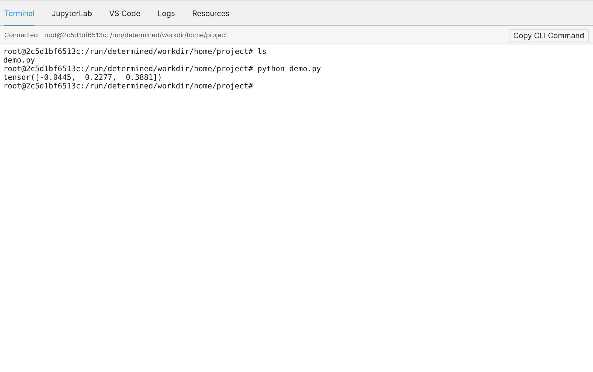
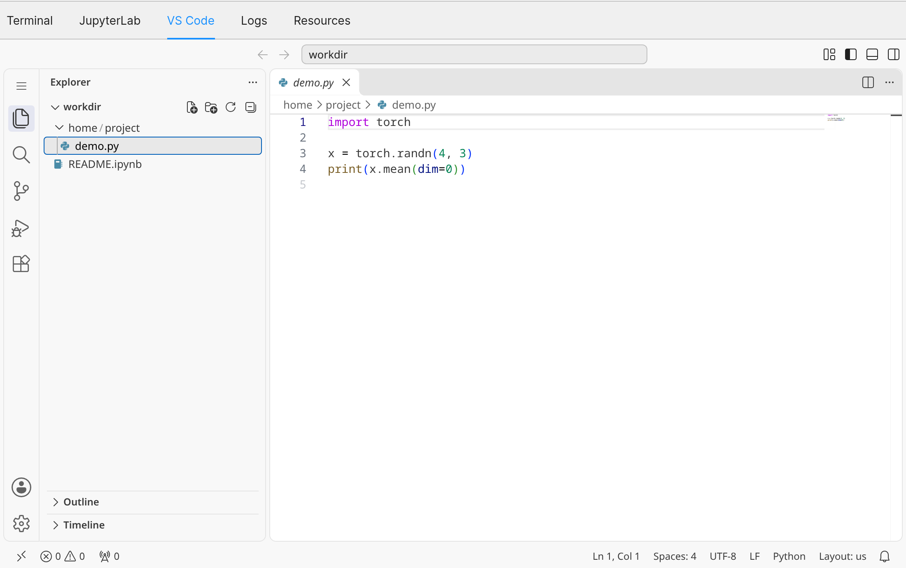
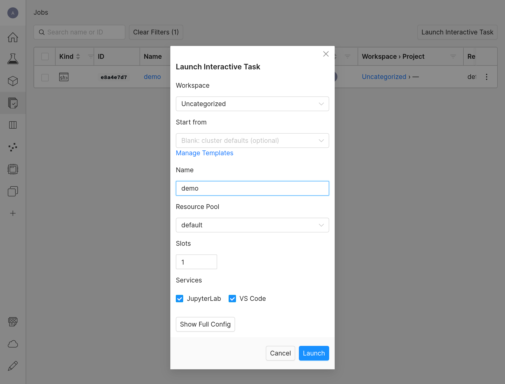
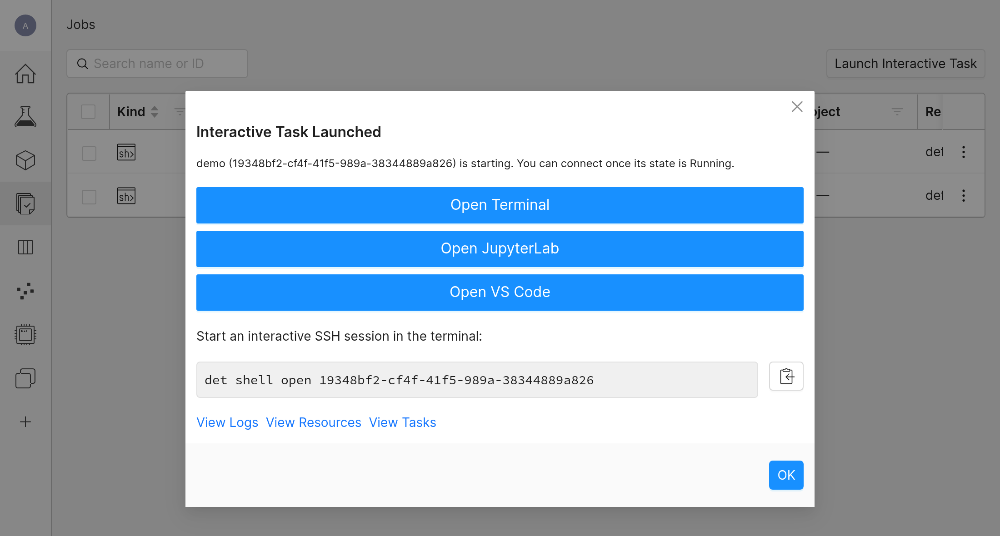

[English](Interactive_Shell.md) | [简体中文](Interactive_Shell.zh.md)

<a id="interactive-shells-ides-and-ports"></a>
# 交互式 Shell、IDE 与端口

Agent 辅助的 shell 管理请使用规范的 [Determined Cluster MCP 工作流](https://github.com/WU-CVGL/determined_cluster_mcp/blob/main/docs/agent-workflow.zh.md)。本页介绍 CVGL 交互式访问、IDE 连接和 shell 生命周期，也提供手动操作所需的原生 CLI 命令。

Determined shell 是临时的交互式开发环境。它在同一容器中运行 SSH 服务器，默认还运行 JupyterLab 和浏览器版 VS Code。它适合检查镜像、复现问题、使用 Notebook 或连接 IDE。需要保留的编辑内容、缓存和调试输出应放在共享存储上。

无人值守的一次性脚本使用 command。长时训练或跨夜工作使用带共享检查点的 experiment。

<a id="start-a-shell"></a>
## 启动 shell

先检查当前调度 slot：

```bash
det slot list
```

检查 [`examples/compute/shell.yaml`](../examples/compute/shell.yaml)，替换其中的占位符，然后启动 shell：

```bash
det shell start --config-file examples/compute/shell.yaml
```

Shell 就绪后，该命令会通过 SSH 连接。若要立即分离并打印 ID：

```bash
det shell start --detach --config-file examples/compute/shell.yaml
```

没有可用 slot 时，原生 `det shell start` 可能进入队列。MCP 的容量和准入行为以规范的[计算服务参考](https://github.com/WU-CVGL/determined_cluster_mcp/blob/main/docs/compute-service.zh.md)为准。

<a id="reconnect-and-stop"></a>
## 重连与停止

列出自己的 shell 并重新连接：

```bash
det shell list
det shell open <shell-id>
```

其他工具需要底层 SSH 命令时，将其打印出来：

```bash
det shell show-ssh-command <shell-id>
```

`show-ssh-command` 是当前写法。旧的 `show_ssh_command` 别名已弃用。

完成后停止 shell：

```bash
det shell kill <shell-id>
```

若要让 shell 在一段时间未使用后结束，在配置中设置 `idle_timeout`，例如 `idle_timeout: 2h`。SSH 会话、浏览器终端、对其服务的请求和正在执行的 kernel 都算作活动。无论是否设置，GPU [回收策略](#shell-cleanup-policy)都适用。

<a id="jupyterlab-and-vs-code-in-the-browser"></a>
## JupyterLab 与浏览器版 VS Code

Shell 在 SSH 服务器旁运行 JupyterLab 和浏览器版 VS Code（code-server），使用相同的用户、文件和挂载。列出它的服务及其状态：

```bash
det task services <shell-id>
```

服务变为 `READY` 后打开它：

```bash
det task open <shell-id> jupyter
det task open <shell-id> vscode
```

在 WebUI 中，于 **Jobs** 页面点击 shell 的名称。它的页面有 **Terminal**、**JupyterLab**、**VS Code**、**Logs** 和 **Resources** 标签页。

**Terminal** 标签页在 shell 中打开命令行：



**VS Code** 标签页在 shell 的工作目录中打开 VS Code：



若要从 WebUI 启动 shell，在 **Jobs** 页面选择 **Launch Interactive Task**，并在 **Services** 下勾选需要的 **JupyterLab** 和 **VS Code**。在 **Show Full Config** 中加入 `shell.yaml` 的 `bind_mounts`。

勾选两个服务的表单：



点击 **Launch** 后，可在弹出的对话框中打开 shell 的终端、JupyterLab 或 VS Code：



若要不运行某个服务，添加 `--no-service <name>`：

```bash
det shell start --config-file examples/compute/shell.yaml --no-service vscode
```

<a id="vs-code-remote-ssh"></a>
## VS Code Remote SSH

1. 安装 **Remote - SSH** 扩展。
2. 在运行 VS Code 的计算机上执行 `det shell show-ssh-command <shell-id>`。
3. 通过 **Remote-SSH: Add New SSH Host** 添加打印出的命令。
4. 连接新主机，并打开映射后的项目目录，例如 `/run/determined/workdir/home/project`。

生成的命令包含保留的任务密钥和 Determined 的代理命令。新的 shell ID 应生成新的配置项。不要将私钥材料复制到仓库中。

<a id="pycharm"></a>
## PyCharm

1. 使用 `det shell show-ssh-command <shell-id>` 生成 SSH 命令。
2. 将其转换为 OpenSSH 配置项，保留 `ProxyCommand`、identity file 和其他选项。
3. 在 **Settings | Tools | SSH Configurations** 中选择 **OpenSSH config and authentication agent**。
4. 测试连接，随后按需将其用于远程解释器。

PyCharm UI 可能无法表示生成命令中的每个选项，因此 OpenSSH 配置项才是可靠来源。

<a id="forward-a-local-port"></a>
## 转发本地端口

在 `--` 之后传递 SSH 选项。例如，将容器端口 `7007` 转发到同号本地端口：

```bash
det shell open <shell-id> -- -L7007:localhost:7007
```

然后在 shell 内启动服务，使其监听容器 loopback 接口，并在本地打开 `http://localhost:7007`。

也可以在第一次连接时转发端口：

```bash
det shell start --config-file examples/compute/shell.yaml -- -L7007:localhost:7007
```

如果 `7007` 已被占用，请选择未使用的本地端口。只暴露必要端口，不要将未认证服务绑定到公共接口。

<a id="keep-work-recoverable"></a>
## 让工作保持可恢复

- 在映射工作区内编辑代码。
- 将调试产物写入映射输出目录。
- 将容器其他位置安装的软件包和文件视为可丢弃内容。
- 记录复现会话所需的镜像 tag 和代码修订版。
- 将长时训练或跨夜工作迁移到带共享检查点的 experiment。

<a id="shell-cleanup-policy"></a>
## Shell 清理策略

以下清理规则适用于占用 GPU 的 **shell**（包括只使用 JupyterLab 或 VS Code 的 shell），衡量容器 GPU 利用率，而不是键盘、SSH 或浏览器活动。

- Grafana 每 60 秒评估一次规则。
- 当 shell 映射到的 GPU 最大利用率持续 15 分钟低于 10% 时，进入 alerting 状态。
- Watchdog 每 30 分钟检查一次（每小时的 :00 和 :30）。第一次匹配时发送警告；如果同一告警在下一次检查时仍存在，就停止该 shell。
- 30 分钟 query window 只是读取数据的窗口，不是额外等待时间。
- 此规则不会将 No Data 和查询错误状态视为告警；watchdog 不会停止 command、TensorBoard 和 experiment。

若 GPU 利用率持续偏低，根据评估和检查时刻的相位，警告与清理流程给出的理论停止时间约为 45–75 分钟。这不是严格的超时，也不是保证的截止时间；检查时机和服务故障都可能改变它。

被停止的 shell 无法重连。请将工作保存在共享存储上，并及时处理警告。无人值守的一次性脚本使用 command；长时训练和跨夜工作使用 experiment。

部署源码由[集群参考](Cluster_Reference.zh.md)链接。应使本说明与 watchdog 和 Grafana 配置保持一致。
