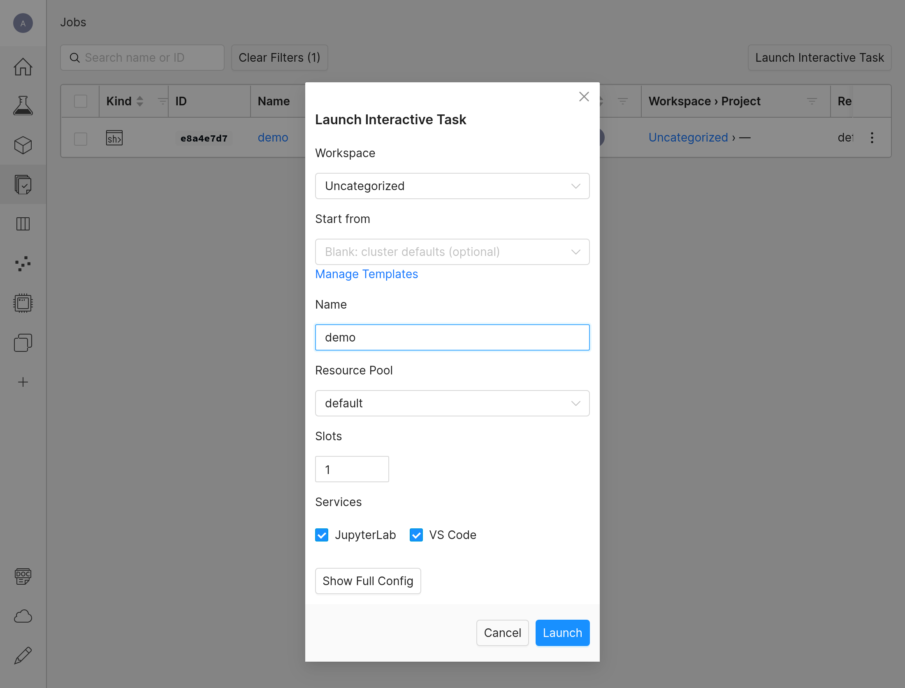
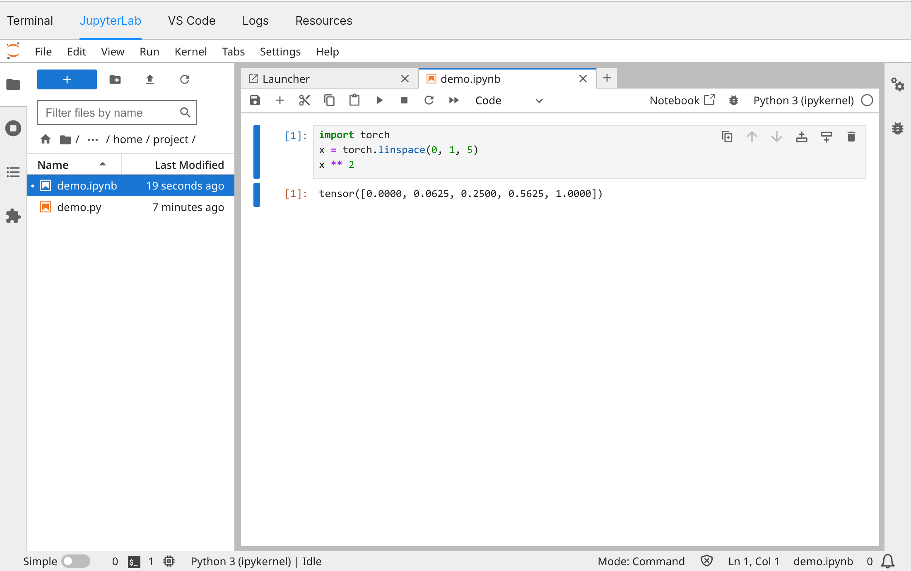
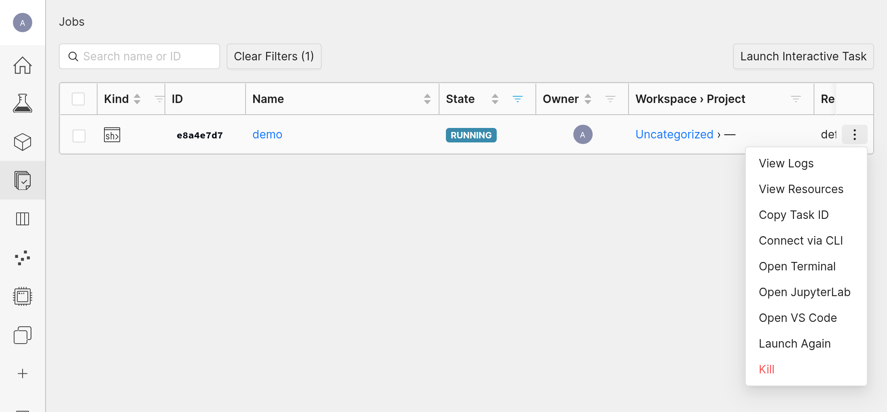

# Jupyter for interactive research

[English](Jupyter_Notebooks.md) | [简体中文](Jupyter_Notebooks.zh.md)

[Home](../README.md) · [Task selection](Determined_AI_User_Guide.md)

Jupyter is an optional interface for research that benefits from inspecting intermediate results. A notebook combines runnable code, explanatory text, equations and visual output in one document. See the [Jupyter introduction](https://docs.jupyter.org/en/latest/).

## When to use it

| Work | Examples |
| --- | --- |
| Explore and check data | Inspect samples, labels, distributions and outliers |
| Analyze model results | Compare checkpoints, plot metrics and inspect failure cases |
| Prototype an algorithm | Check tensors, gradients, geometric transforms or loss functions step by step |
| Visualize interactively | Adjust parameters and inspect images, point clouds or plots |
| Teach or share research | Present explanations, code and results together |

For repeatable batch evaluation and agent-driven scripts, prefer a command. Use an experiment for long or overnight training. Move reusable logic into Python modules and keep notebooks focused on exploration and presentation. Before sharing a notebook, restart its kernel and run all cells in order to check that it does not rely on leftover state.

## Start JupyterLab in a shell

A shell runs JupyterLab by default, next to its SSH server. Complete the [CLI setup](Determined_AI_User_Guide.md#install-and-authenticate) first; the canonical [compute-service reference](https://github.com/WU-CVGL/determined_cluster_mcp/blob/main/docs/compute-service.md) lists the task kinds available through MCP.

Copy the shared-mount template:

```bash
cp examples/compute/shell.yaml jupyter.yaml
```

Edit `jupyter.yaml`: replace the user, pool and image placeholders, choose an image with JupyterLab (`jupyter` on its `PATH`), and set a meaningful `description`. Use `resources.slots: 0` for CPU-only analysis; request GPUs only when the analysis needs them. Check the selected pool's schedulable slots or auxiliary-container capacity as appropriate. Shell submissions can queue.

Start the shell without a file context:

```bash
det shell start --detach --config-file jupyter.yaml
```

Do not add `--context` or `--include`. Open or create `.ipynb` files under the mapped shared workspace, and read datasets through their shared mounts.

List your shells and a shell's services, then open JupyterLab once `jupyter` is `READY`:

```bash
det shell list
det task services <shell-id>
det task open <shell-id> jupyter
```

If the image has no JupyterLab, `jupyter` is `UNAVAILABLE` and the shell runs on.

In the WebUI, select **Launch Interactive Task** on the **Jobs** page, keep **JupyterLab** checked under **Services**, and add the `bind_mounts` from `jupyter.yaml` under **Show Full Config**. Open JupyterLab in the **JupyterLab** tab of the shell's page, or choose **Open JupyterLab** from the shell's action menu.

The launch form:



The **JupyterLab** tab of the shell's page:



The shell's action menu on the **Jobs** page:



## Save work and release resources

Keep notebooks, inputs and results on [shared storage](Shared_Storage.md). Saving an `.ipynb` file does not preserve all kernel memory; write required artifacts to files. Closing a browser tab does not stop the shell or release its allocated resources. Stop the shell when finished:

```bash
det shell kill <shell-id>
```

**Shells that hold GPUs follow the [cleanup policy](Interactive_Shell.md#shell-cleanup-policy), also when only JupyterLab is used:** a shell whose GPUs stay idle is warned and later stopped. CPU-only shells are not stopped by it.

A shell that sets `idle_timeout` also ends after that long without activity; a busy kernel counts as activity. See [Interactive Shell](Interactive_Shell.md#reconnect-and-stop).
